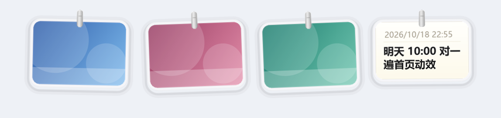

<div align="center">

# LineDry · 晾衣绳

**每一张截图都挂到屏幕顶边的绳子上。指针停在顶边，绳子滑下来；移开，它收回去。**

Windows 10 / 11 · C# + WinForms + GDI+ 全自绘 · 零第三方依赖 · 单文件约 165 KB

[](#)
[](#)
[](#)
[](#)
[](LICENSE)



</div>

> **A Windows port of [Tendedero](https://github.com/alejandrobujan/tendedero)** — every screenshot hangs out to dry on a line at the top of your screen.
> C# 5 · WinForms · GDI+ · per-pixel-alpha layered window · no third-party dependencies · one 165 KB exe · eleven languages.

---

## 关于这个项目

LineDry 是 macOS 小工具 **Tendedero** 的 Windows 移植版：每截一张图，它挂到屏幕顶边的绳子上；
指针停在顶边，绳子滑下来，移开则收起。截图不再堆积在桌面，随手要用的图始终在视线之上。

**做它的原因**：这个想法本身很有意思，但它只有 macOS 版。既然 Windows 上没有，
就参照它的行为规格，用 Windows 原生的方式重新实现了一个。

如果 LineDry 对你有用，欢迎点一个 Star；这类小工具的后续维护，多半就靠这一点反馈支撑。

## 特性

- **截图直接上绳**：桌面与图片文件夹不留副本，只有主动拖出去的那张才落盘。
- **不打扰**：不联网、无账号、无统计；全屏程序在前时自动收起；不抢焦点、不进任务栏与 Alt-Tab。
- **窗口逐像素透明**：空白处的鼠标事件直接穿透，只有卡片本身可交互。
- **单文件，约 165 KB**：纯 C# + WinForms + GDI+ 全自绘——绳子、玻璃相框、金属夹子、
  托盘图标与应用图标均由代码绘制。
- **零第三方依赖**：拷贝到任意 Windows 10 / 11 即可运行，无需安装运行时或 SDK。

## 操作一览

| 操作 | 结果 |
|---|---|
| 指针停在**屏幕最顶端** | 绳子滑下来（按住拖拽时，顶边 72 px 范围内同样有效） |
| 指针移开 | 0.5 秒后收起 |
| **单击**卡片 | 复制这张图（位图与文件同时写入剪贴板） |
| **长按**卡片 | 用「画图」打开，保存后缩略图自动刷新 |
| **双击**卡片 | 用默认程序打开；右键「预览」可全屏查看（←/→ 翻页，Esc 关闭） |
| **拖进文件夹** | 保存到该文件夹，并从绳上取下 |
| **拖进回收站** | 删除（可还原） |
| 把图片文件**拖到屏幕顶端** | 挂到绳上；原文件保持原位，绳上是引用 |
| **复制一段文字** | 生成一张文字卡，最多同时三张 |
| 左键点**托盘图标** | 设置：接管截图、挂上复制内容、收起动画时长、大小、快捷键、开机自启等 |

## 运行与构建

双击 `LineDry.exe` 即可运行，无主窗口，直接进入托盘。

自行构建不需要任何 SDK，也不需要联网：

```cmd
build.cmd
```

只使用 `%WINDIR%\Microsoft.NET\Framework64\v4.0.30319\csc.exe`（.NET Framework 4.8 自带），
产物为 `build\LineDry.exe`。

设置保存在 `HKCU\Software\LineDry`，删除该键即恢复出厂状态。

---

## 一、它做什么

每截一张图，它就挂到屏幕顶边的一根绳子上。

指针停在**屏幕最顶端**，绳子滑下来；移开，它收回去。单击卡片即复制，长按就地编辑，
拖进文件夹即保存，拖到回收站即删除。整个过程不联网、无账号、无统计。

---

## 二、借鉴：行为规格从哪里来

它的行为规格不是从二进制里猜出来的，而是一次**有据可依的借鉴**：
原作 Tendedero 以 MIT 许可开源，源码就在仓库里。既然规格的权威来源已经公开，
正确做法是**读源码**，把它可复用的行为一条条记录下来，再用 Windows 的原生手段重新实现。

这里有一个判断值得说明：反汇编是从**没有源码**时才需要付出的代价。手里已有可信的源码，
却仍去逆二进制，等于主动把准确率从"确定"降到"大概"，同时多付出数倍工时。
动手之前先确认手中是否存在更权威的资料，比急着动手更重要。

源码共 17 个 Swift 文件、约 137 KB，全部读过之后提炼出以下行为规格：

| 项 | 值（读自源码） |
|---|---|
| 绳子的形状 | 抛物线，`sag = min(30, 屏宽 × 0.018)`；从 `y = 10` 垂下 |
| 相框 | 圆角 16、内缩 4；照片圆角 = 16 − 4 = 12（同心圆角） |
| 夹子 | 9 × 26，圆角 3.5，槽位于顶部 +8.5 处，压在卡片顶部 12 px 上 |
| 卡片尺寸 | 宽 `150 × size`，照片最大高 `104 × size`；三档 0.8 / 1.0 / 1.35 |
| 倾斜 | 每张在 `−2.5° ~ +2.5°` 之间随机 |
| 摇摆 | 新挂上时从 16° 弹回；微风每 7~16 秒出现一次，扰动 1.6°~3.4° |
| 掉落 | 下坠 520 px、继续翻转、淡出，0.55 s，三次方缓入 |
| 绳上容量 | 最多 8 张；「绳上保留」可选 25 / 50 / 100 |
| 自动收起 | 指针离开 0.5 s 后收起；停在顶边 0.25 s 后放下 |
| 收起动画时长 | 托盘菜单可选 立即 / 0.15 / 0.32（默认）/ 0.6 / 1 秒；选「立即」时不绘制任何过渡帧。行程只走到当前内容的底边（最低一张卡片的下缘，空绳时取提示文字），不做屏幕外的空滑；缓动使用 smoothstep，均匀铺满整段时间 |
| 复制反馈 | 「已复制」胶囊显示 1.2 s |
| 取下与掉落 | 先绕夹子松脱（0.13 s：下沉 8 点、旋转 7°），再匀加速下落（距离与时间平方成正比）并轻微飘移，末段 45% 才开始淡出；同时其余卡片滑动补位，整段约 0.62 s |
| 文字卡 | 卡面为 Apple 备忘录式纸面：暖白纵向渐变、细边、灰色日期行、加粗首行；挂在绳上与照片共用夹子、玻璃框与阴影，宽度同卡片、高度随文字自适应；最多同时三张 |
| 连取下坠 | 逐张掉落，每张间隔 0.06 s，仅第一张出声 |
| 快捷键 | 原版默认 `⌃⌥T` |

此外还有一套状态机——何时放下、何时收起、何时保持不动——它是原版手感的核心，
本移植版逐条对应到 `Launcher.Tick`。

---

## 三、macOS → Windows 机制映射

移植的难点不在翻译代码，而在两套系统的窗口模型不同。macOS 侧的 NSPanel、Space、菜单栏、
截图文件上的扩展属性，在 Windows 上都没有直接对应物，必须用 Win32 重建等价能力：

| 原版（macOS） | 本移植版（Windows） |
|---|---|
| `NSPanel` 无边框透明浮层，`level = .floating` | 无边框 `Form` + `WS_EX_LAYERED` + `UpdateLayeredWindow` 逐像素 alpha |
| `ignoresMouseEvents`（除照片外点击穿透） | `WM_NCHITTEST` 动态返回 `HTTRANSPARENT` / `HTCLIENT` |
| 跨所有 Space、全屏辅助 | `WS_EX_TOOLWINDOW`（不进任务栏 / Alt-Tab） |
| `canBecomeKey = false` 永不抢焦点 | `WS_EX_NOACTIVATE` + `ShowWithoutActivation` |
| 菜单栏图标 `NSStatusItem` | 系统托盘 `NotifyIcon`（图标同样由代码绘制） |
| 指针停在菜单栏 → 放下绳子 | 指针停在屏幕顶端 → 放下绳子（Windows 顶边没有菜单栏） |
| Carbon `RegisterEventHotKey` | `RegisterHotKey` + `WM_HOTKEY` |
| `FileManager.trashItem` | `SHFileOperation(FO_DELETE + FOF_ALLOWUNDO)` |
| 截图落点由 `com.apple.screencapture` 决定 | 已知文件夹 `{B7BEDE81-…}`（`Pictures\Screenshots`）；「接管截图」= 改写该键并备份原值 |
| `kMDItemIsScreenCapture` 扩展属性 | Windows 无等价标记，改用目录 + 扩展名 + 文件名的稳定检测 |
| `getxattr` 读取截取区域 → 卡片飞入 | 无此元数据，改为从绳子上方弹入（见 §六） |
| `NSPasteboard.changeCount` 轮询 0.5 s | `GetClipboardSequenceNumber()` 轮询 0.5 s |
| `org.nspasteboard.ConcealedType` 私密标记 | `ExcludeClipboardContentFromMonitorProcessing` / `CanIncludeInClipboardHistory` 等 |
| 系统 Markup 标注扩展 | `mspaint.exe`（Windows 上最接近的系统图像编辑器） |
| Quick Look | 自建全屏预览窗（←/→ 翻页，Esc 关闭） |
| `SMAppService` 登录项 | `HKCU\…\CurrentVersion\Run` |
| `UserDefaults` | `HKCU\Software\LineDry`（键名沿用原版） |
| `.lproj/Localizable.strings` | 直接复用原版 11 种语言的翻译文件 |
| 全屏 Space 检测（私有 CGS API） | `SHQueryUserNotificationState()` |

---

## 四、技术选型

目标是一个不依赖运行时、体积小、外观完全自绘的常驻工具，因此选择了：

```
C# 5  +  WinForms  +  GDI+ 全自绘  +  UpdateLayeredWindow
```

理由：

1. **零下载、零安装**：`build.cmd` 直接调用系统自带的 `csc.exe`，一条命令产出 exe。
2. **体积可控**（最终约 165 KB）。原作的一个特点就是"轻"，
   用 Electron 之类的框架包装成上百 MB，并不符合这个项目的定位。
3. **透明窗口足以胜任**：原作的图形全部由代码绘制，本移植版同样用 GDI+ 重绘——
   绳子（三层描边 + 两端渐隐）、玻璃相框（高光边 + 柔和投影）、金属夹子、圆角角标、
   播放按钮、托盘图标。
4. **不需要 SDK**：`csc` + `/resource:` 内嵌 11 个语言文件 + `app.manifest` 声明 PerMonitorV2 DPI。

因此该程序拷贝到任意一台 Windows 10 / 11 上即可双击运行，不需要安装运行时。

---

## 五、使用说明

```
build\LineDry.exe        ← 双击运行（无主窗口，进入托盘）
```

| 操作 | 结果 |
|---|---|
| 指针停在屏幕最顶端 | 绳子滑下来 |
| 指针移开 | 0.5 秒后收起 |
| `Ctrl + Alt + T` | 显示 / 隐藏绳子（可在托盘菜单中修改） |
| 单击卡片 | 复制这张图（位图 + 文件一并写入剪贴板） |
| 长按卡片 | 用「画图」打开，保存后自动刷新缩略图 |
| 双击卡片 | 用默认程序打开 |
| 拖到文件夹 | 保存到该文件夹，并从绳上取下 |
| 拖到回收站 | 删除（可还原） |
| 把图片文件拖到屏幕顶端 | 直接挂到绳上；原文件保持原位 |
| 点卡片左上角按钮 | 位于自身文件夹的图 → 移入回收站；其他位置的图 → 仅从绳上取下 |
| 右键卡片 | 复制 / 打开 / 预览 / 编辑 / 在资源管理器中显示 / 取下 / 移到回收站 / 全部取下 |
| 左键点托盘图标 | 设置菜单 |
| 复制一段文字 | 生成文字卡（托盘菜单「挂上复制的文字」可关闭）；第四段进入时最旧的一张自动退场 |
| 文字卡 | 与照片同一套交互：双击或右键「打开」→ 记事本；「预览」；「编辑文字」→ 记事本（保存后自动读回并重绘纸面）；「在资源管理器中显示」「保存到桌面」「取下」；也可把文字拖入其他程序（拖到文件夹则存为 `.txt`）。文字本身没有文件，需要时才在 `%TEMP%\LineDry\` 中生成 |
| 鼠标滚轮 | 绳上内容超过一屏时横向滚动 |

托盘菜单可修改：接管截图、挂上复制的图片、挂上复制的文字、放下绳子的方式、收起动画时长、
同时监视的文件夹、绳上保留数量、大小（小 / 中 / 大）、快捷键、声音、开机自启。

「接管截图」会把 Windows 的「屏幕截图」已知文件夹改为 `%LOCALAPPDATA%\LineDry\Screenshots`，
并**备份原本的设置**，关闭时原样还原。

设置保存在 `HKCU\Software\LineDry`，删除该键即完全恢复出厂状态。

### 构建

```cmd
build.cmd
```

只使用 `%WINDIR%\Microsoft.NET\Framework64\v4.0.30319\csc.exe`，无需安装任何组件。

---

## 六、范围与取舍

**完整实现的**：绳索与相框的几何与观感、倾斜、摇摆、微风、八张上限与自动淘汰最旧一张、
三档尺寸、逐张下坠、顶边手势、收起计时、单击 / 长按 / 双击 / 右键全部行为、拖出与拖入、
回收站语义、"仅自身文件夹中的图才真正删除"这一边界、剪贴板监听与去重、私密内容跳过、
同时监视最多三个文件夹、托盘菜单全集、全局快捷键、开机自启、11 种语言、全屏时自动避让。

**明确取舍的**：

- **飞入动画**：原版依据 macOS 记录在文件上的截取坐标，从截图区域飞入绳上。
  Windows 不提供该元数据，改为从绳子上方 46 px 弹簧落下，保留"挂上去"的动作感。
- **「接管截图」的范围**：Windows 没有统一的截图设置项。本版可靠做到的是改写「屏幕截图」
  已知文件夹（Win + PrtScn 与截图工具的自动保存均读取它），并额外监视原目录作为兜底。
- **「编辑」**：原作使用系统 Markup 标注扩展，Windows 无对应物，改用「画图」。
- **「预览」**：原作使用 Quick Look，Windows 无系统级快速查看，改为自建全屏预览窗。
- **屏幕录制剪辑**：未实现（原作使用 AVPlayerView，Windows 无对应物）；
  长按录制文件改用默认播放器打开。

**未实现的**：菜单栏图标（Windows 无菜单栏，改为托盘）、Force Touch 用力点按（Windows 触控板无此档位）。

**需要手动确认的部分**：右键菜单、拖拽到文件夹与回收站、长按标记、全屏避让。
这些涉及真实拖放与外部程序，自动化测试会干扰桌面环境，因此保留为手动验证项。

---

## 七、许可与致谢

原项目 **Tendedero** 由 [Alejandro Buján](https://alejandrobujan.com/) 设计与开发，
代码以 MIT 许可发布：<https://github.com/alejandrobujan/tendedero>。

原项目明确说明：**名称与图标不在 MIT 授权范围内**，衍生版本需要自备名称与图标。
因此本移植版名为 **LineDry**，图标与全部界面图形均为重新绘制。

本移植版同样以 MIT 许可发布，11 种语言的翻译文件沿用原项目（MIT）。

原项目的 MIT 许可全文随仓库保留在 `LICENSE-Tendedero`；本移植版自己的许可见 `LICENSE`。
